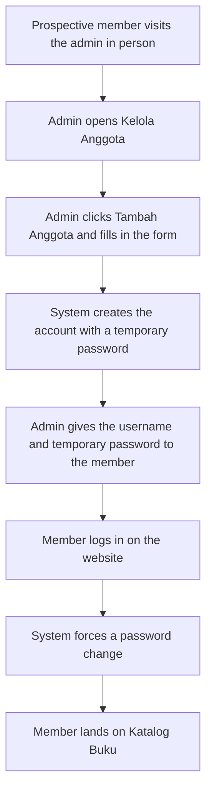
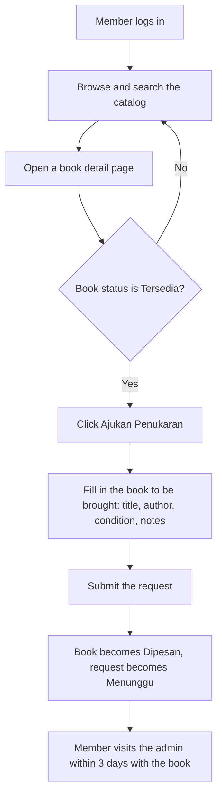
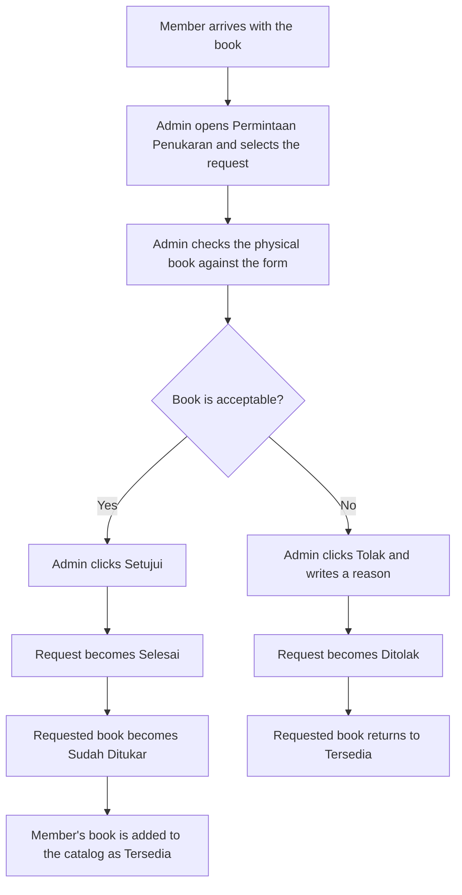
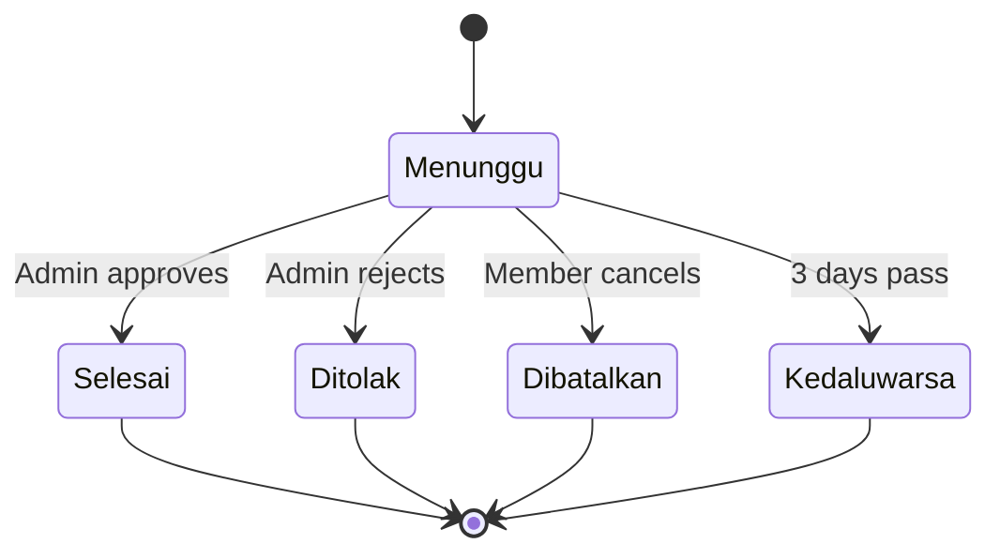

# PRD — FestivalTukarBuku (Book Swap Website)

A web platform where members swap physical books with each other through an admin. Similar to a book-lending website, except books are **exchanged, not borrowed**, and **no payment is involved**.

- **PRD language:** English
- **Website content (UI copy):** Bahasa Indonesia
- **Roles:** Admin, Anggota (Member)

---

## 1. Design & Frontend

### 1.1 Design Principles

| Principle | Description |
|---|---|
| Clean & friendly | Lots of white space, rounded shapes, and a calm blue look that feels like a community library. |
| Book-first | Book covers are the hero of every page. Cards are large, image-led, and easy to scan. |
| Simple for everyone | Members may not be tech-savvy. Few steps, big buttons, clear Indonesian labels. |
| Alive but not noisy | Smooth, purposeful animation that guides attention. No animation that slows down a task. |

### 1.2 Color Palette

The two brand colors are fixed. All other colors are tints/shades of them or neutral colors.

| Role | Name | Hex | Usage |
|---|---|---|---|
| Primary | Biru Utama | `#0747a1` | Primary buttons, links, navbar, active states, headings accent |
| Secondary | Biru Muda | `#90cdf9` | Highlights, badges, hover backgrounds, illustrations, gradient end |
| Primary dark | Biru Tua | `#05357a` | Button hover/pressed state |
| Tint 100 | Biru Langit | `#e8f4fe` | Page sections, card hover, table row hover |
| Tint 50 | Biru Awan | `#f5faff` | App background |
| Text main | Tinta | `#0b1f3a` | Body text and headings |
| Text muted | Abu Biru | `#5b6b82` | Secondary text, placeholders |
| Border | Garis | `#d6e6f5` | Borders and dividers |
| Surface | Putih | `#ffffff` | Cards, modals, inputs |

**Status colors** (used only for status badges and alerts, never for branding):

| Status | Hex | Used for |
|---|---|---|
| Success | `#16a34a` | Tersedia, Selesai |
| Warning | `#d97706` | Dipesan, Menunggu |
| Danger | `#dc2626` | Ditolak, error messages |
| Neutral | `#64748b` | Sudah Ditukar, Dibatalkan, Kedaluwarsa |

**Signature gradient:** `linear-gradient(135deg, #0747a1 0%, #90cdf9 100%)` — used on the hero section, login page panel, and dashboard stat cards.

**Contrast rules:** White text on `#0747a1` (about 8.7:1) and `#0b1f3a` text on `#90cdf9` are the approved combinations. Never place white text on `#90cdf9`.

### 1.3 Typography

| Use | Font | Weight |
|---|---|---|
| Headings | Plus Jakarta Sans | 700 / 800 |
| Body & UI | Inter | 400 / 500 / 600 |

| Token | Size (desktop / mobile) |
|---|---|
| H1 | 48px / 32px |
| H2 | 32px / 24px |
| H3 | 24px / 20px |
| Body | 16px / 16px |
| Small | 14px / 14px |

### 1.4 Layout, Shape & Spacing

- 8px spacing grid. Container max-width 1200px.
- Border radius: cards 16px, buttons 12px, inputs 12px, badges full-round.
- Shadow: soft, blue-tinted (`0 8px 24px rgba(7, 71, 161, 0.10)`).
- Book cover ratio: 2:3.
- Public and member pages use a top navbar. Admin pages use a left sidebar (collapses to a drawer on mobile).

### 1.5 Motion & Animation

**Framer Motion** is the main animation library. **React Bits** is used for a few showpiece components so the site looks polished without overloading it.

| Where | Library | Effect |
|---|---|---|
| Page transitions | Framer Motion | `AnimatePresence`, fade + 12px slide-up, 250ms |
| Book card grid | Framer Motion | Staggered reveal on load and when scrolled into view (`whileInView`) |
| Book card hover | Framer Motion | Lift up 4px + shadow grows (`whileHover`), cover scales to 1.03 |
| Buttons | Framer Motion | `whileTap` scale 0.97 |
| Modals & drawers | Framer Motion | Spring in/out with dimmed backdrop |
| Status badges | Framer Motion | Soft scale-pop when the status changes |
| Toasts | Framer Motion | Slide in from top-right, auto-dismiss in 4s |
| Landing hero heading | React Bits | Animated text (Split Text / Blur Text) |
| Featured book cards | React Bits | Spotlight Card hover effect |
| Admin dashboard numbers | React Bits | Count Up animation on stat cards |
| Loading | Framer Motion | Skeleton shimmer for cards and tables |

**Rules:** Respect `prefers-reduced-motion` (disable movement, keep fades). No animation longer than 600ms. Never block user input while an animation plays.

### 1.6 Key UI Components

- **Navbar / Sidebar** — logo, navigation, profile menu with "Keluar".
- **BookCard** — cover, title, author, genre chip, condition chip, status badge.
- **BookDetail** — large cover, full info, "Ajukan Penukaran" button.
- **SearchBar & FilterPanel** — keyword search, genre, condition, availability.
- **SwapRequestForm** — form for the book the member will bring.
- **StatusBadge** — color-coded, see status colors above.
- **DataTable** (admin) — search, sort, pagination, row actions.
- **Modal / ConfirmDialog** — for approve, reject, delete, and reset password actions.
- **Toast** — success and error feedback.
- **EmptyState** — friendly illustration and text when a list is empty.
- **Skeleton loaders** — for every list and detail view.

### 1.7 Page Inventory

**Public**

| Page | Route | Content |
|---|---|---|
| Beranda (Landing) | `/` | Hero, how it works (3 steps), featured books, "Cara Bergabung" section explaining that people must visit the admin to get an account, footer |
| Masuk (Login) | `/masuk` | Split layout: gradient illustration panel + login form |

**Anggota (Member)**

| Page | Route | Content |
|---|---|---|
| Katalog Buku | `/katalog` | Search, filters, book grid with pagination |
| Detail Buku | `/katalog/:id` | Book info and swap button |
| Ajukan Penukaran | `/katalog/:id/tukar` | Swap request form |
| Permintaan Saya | `/permintaan` | List of own swap requests with status |
| Riwayat Penukaran | `/riwayat` | Completed swaps |
| Profil | `/profil` | Own data (read-only) and change password |

**Admin**

| Page | Route | Content |
|---|---|---|
| Dashboard | `/admin` | Stat cards (total books, available books, total members, pending requests), latest requests |
| Kelola Buku | `/admin/buku` | Book table, add, edit, delete |
| Form Buku | `/admin/buku/baru`, `/admin/buku/:id/ubah` | Book form with cover upload |
| Kelola Anggota | `/admin/anggota` | Member table, add, edit, deactivate, reset password |
| Form Anggota | `/admin/anggota/baru`, `/admin/anggota/:id/ubah` | Member form |
| Permintaan Penukaran | `/admin/permintaan` | Request table with status tabs, process requests |
| Detail Permintaan | `/admin/permintaan/:id` | Member info, requested book, book brought by member, approve / reject |

### 1.8 UI Language Guide (Bahasa Indonesia)

All user-facing text is in Indonesian, using a friendly but polite tone (use "Anda" or neutral phrasing, avoid slang).

| Context | Indonesian copy |
|---|---|
| App name | FestivalTukarBuku |
| Hero heading | "Tukar Bukumu, Temukan Cerita Baru" |
| Hero subtext | "Punya buku yang sudah selesai dibaca? Tukarkan dengan buku lain, tanpa biaya." |
| Login | Masuk, Keluar, Kata Sandi, Nama Pengguna |
| Catalog | Katalog Buku, Cari judul atau penulis…, Semua Genre, Kondisi, Ketersediaan |
| Book status | Tersedia, Dipesan, Sudah Ditukar |
| Book condition | Seperti Baru, Baik, Layak Baca |
| Swap action | Ajukan Penukaran, Batalkan Permintaan |
| Request status | Menunggu, Selesai, Ditolak, Dibatalkan, Kedaluwarsa |
| Admin actions | Tambah Buku, Tambah Anggota, Ubah, Hapus, Nonaktifkan, Atur Ulang Kata Sandi, Setujui, Tolak |
| Success toast | "Permintaan penukaran berhasil dikirim." |
| Error toast | "Terjadi kesalahan. Silakan coba lagi." |
| Empty state | "Belum ada buku yang tersedia." |
| Join info | "Ingin bergabung? Datang langsung ke admin untuk mendaftar sebagai anggota." |

### 1.9 Responsiveness & Accessibility

- Mobile-first. Breakpoints: 360px (mobile), 768px (tablet), 1024px+ (desktop).
- Book grid: 2 columns on mobile, 3 on tablet, 4 on desktop.
- Admin tables become stacked cards on mobile.
- WCAG 2.1 AA: visible focus ring (`#90cdf9` 3px outline), keyboard navigation, alt text on covers, labels on all inputs.
- `<html lang="id">`.

---

## 2. Requirements

### 2.1 Roles & Permissions

| Capability | Admin | Anggota |
|---|---|---|
| Log in / log out | ✅ | ✅ |
| Register by themselves | ❌ | ❌ |
| Create / edit / deactivate member accounts | ✅ | ❌ |
| Reset a member's password | ✅ | ❌ |
| Add / edit / delete books | ✅ | ❌ |
| Browse and search the catalog | ✅ | ✅ |
| Submit a swap request | ❌ | ✅ |
| Cancel own pending swap request | ❌ | ✅ |
| Approve / reject swap requests | ✅ | ❌ |
| View own swap history | ❌ | ✅ |
| View all swap history and dashboard | ✅ | ❌ |
| Change own password | ✅ | ✅ |

### 2.2 Functional Requirements

**Authentication**

| ID | Requirement |
|---|---|
| FR-01 | Users log in with username and password. |
| FR-02 | There is no public registration page or endpoint. |
| FR-03 | Members created by the admin must change their temporary password on first login. |
| FR-04 | Deactivated members cannot log in. |
| FR-05 | Routes and API endpoints are protected by role. A member must never reach admin pages. |

**Book management (Admin)**

| ID | Requirement |
|---|---|
| FR-06 | Admin can add a book: title, author, genre, condition, description, publisher (optional), year (optional), cover image. |
| FR-07 | Admin can edit and delete a book. A book with a pending request cannot be deleted. |
| FR-08 | Admin can see all books in a searchable, filterable, paginated table. |
| FR-09 | Each book is a single physical copy and has one status: Tersedia, Dipesan, or Sudah Ditukar. |

**Member management (Admin)**

| ID | Requirement |
|---|---|
| FR-10 | Admin can create a member: full name, username, phone number, address (optional), temporary password. |
| FR-11 | Username must be unique. |
| FR-12 | Admin can edit member data, deactivate or reactivate a member, and reset a password. |
| FR-13 | Admin can see all members in a searchable, paginated table. |

**Catalog (Anggota)**

| ID | Requirement |
|---|---|
| FR-14 | Members can browse books as a paginated grid (12 per page). |
| FR-15 | Members can search by title or author, and filter by genre, condition, and status. |
| FR-16 | Members can open a book detail page. |

**Swap**

| ID | Requirement |
|---|---|
| FR-17 | A member can request a swap for a book with status Tersedia. |
| FR-18 | The request form asks for the book the member will bring: title, author, condition, and optional notes/photo. |
| FR-19 | When a request is submitted, the requested book becomes Dipesan and the request becomes Menunggu. |
| FR-20 | A member can cancel their own Menunggu request. The book returns to Tersedia. |
| FR-21 | Admin sees all requests and can filter by status. |
| FR-22 | Admin can mark a request as Selesai after checking the physical book in person. |
| FR-23 | When Selesai: the requested book becomes Sudah Ditukar, and the member's book is added to the catalog as a new book with status Tersedia. |
| FR-24 | Admin can reject a request with a reason. The book returns to Tersedia. |
| FR-25 | A pending request expires automatically after 3 days (configurable). The book returns to Tersedia. |
| FR-26 | A member can have at most 2 active (Menunggu) requests at once (configurable). |

**Dashboard & history**

| ID | Requirement |
|---|---|
| FR-27 | Admin dashboard shows total books, available books, total members, pending requests, and the latest requests. |
| FR-28 | Members can see their own request list and completed swap history. |

### 2.3 Business Rules

1. No money is exchanged. The site has no cart, price, or payment feature.
2. Swaps are completed physically at the admin's location. The website records and manages the process only.
3. Each book is one physical copy, so there is no stock quantity.
4. Only the admin changes a request to Selesai or Ditolak.
5. Books are never hard-deleted once they have swap history; they are archived instead.

### 2.4 Non-Functional Requirements

| Area | Requirement |
|---|---|
| Performance | Largest Contentful Paint under 2.5s on a normal 4G connection. Lists are paginated. Search input is debounced (400ms). Images are lazy loaded. |
| Security | Passwords hashed with bcrypt. JWT stored in an httpOnly cookie. Login rate limiting. Input validation on client and server. CORS restricted to the app domain. |
| Image upload | JPG, PNG, WebP only, max 2MB per image. |
| Compatibility | Latest 2 versions of Chrome, Edge, Firefox, and Safari; Android and iOS browsers. |
| Reliability | Atomic status updates so two members cannot reserve the same book at the same time. |
| Maintainability | Component-based structure, consistent naming, environment variables for all secrets. |

### 2.5 Tech Stack

| Layer | Technology |
|---|---|
| Frontend | React (Vite), React Router |
| Styling | Tailwind CSS with the palette from section 1.2 as theme tokens |
| Animation | Framer Motion (primary) + React Bits (selected components) |
| Forms & validation | React Hook Form + Zod |
| Data fetching | TanStack Query + Axios |
| Backend / API | Node.js + Express (REST API) |
| Database | MongoDB with Mongoose |
| Authentication | JWT + bcrypt |
| Image storage | Cloudinary (or local storage in development) |
| Deployment | Frontend on Vercel/Netlify, API on any Node host, MongoDB Atlas |

### 2.6 Data Model (MongoDB)

**`users`**

| Field | Type | Notes |
|---|---|---|
| `_id` | ObjectId | |
| `name` | String | |
| `username` | String | unique |
| `passwordHash` | String | |
| `role` | String | `admin` or `anggota` |
| `phone` | String | |
| `address` | String | optional |
| `isActive` | Boolean | default `true` |
| `mustChangePassword` | Boolean | `true` for new members |
| `createdAt`, `updatedAt` | Date | |

**`books`**

| Field | Type | Notes |
|---|---|---|
| `_id` | ObjectId | |
| `title` | String | |
| `author` | String | |
| `genre` | String | |
| `condition` | String | `seperti_baru`, `baik`, `layak_baca` |
| `description` | String | |
| `publisher`, `year` | String, Number | optional |
| `coverUrl` | String | |
| `status` | String | `tersedia`, `dipesan`, `sudah_ditukar` |
| `source` | String | `admin` or `swap` |
| `sourceSwapId` | ObjectId | set when the book came from a swap |
| `createdAt`, `updatedAt` | Date | |

**`swapRequests`**

| Field | Type | Notes |
|---|---|---|
| `_id` | ObjectId | |
| `member` | ObjectId | ref `users` |
| `requestedBook` | ObjectId | ref `books` |
| `offeredBook` | Object | `title`, `author`, `condition`, `notes`, `photoUrl` |
| `status` | String | `menunggu`, `selesai`, `ditolak`, `dibatalkan`, `kedaluwarsa` |
| `rejectReason` | String | optional |
| `processedBy` | ObjectId | ref `users` (admin) |
| `expiresAt` | Date | |
| `createdAt`, `completedAt` | Date | |

---

## 3. Core Features

### 3.1 MVP (Must Have)

| # | Feature | Description | Role |
|---|---|---|---|
| 1 | Login & role-based access | Secure login, forced password change on first login, separate admin and member areas. | Both |
| 2 | Member management | Admin creates and manages member accounts after the person visits in person. No public registration. | Admin |
| 3 | Book management | Admin adds, edits, deletes, and uploads covers for books. | Admin |
| 4 | Book catalog | Search, filter, and browse available books with an animated, book-first UI. | Anggota |
| 5 | Swap request | Member picks a book and describes the book they will bring. The requested book is reserved. | Anggota |
| 6 | Swap processing | Admin checks the physical book, then completes or rejects the request. The catalog updates automatically. | Admin |
| 7 | Request tracking | Members see request status and swap history. | Anggota |
| 8 | Admin dashboard | Quick numbers and latest requests. | Admin |
| 9 | Animated UI | Framer Motion transitions and micro-interactions, plus a few React Bits components. | Both |

### 3.2 Nice to Have (After MVP)

- WhatsApp or email notification when a request is completed or about to expire.
- Wishlist, so members can save books they want.
- Book reviews and short ratings from members.
- Export reports (CSV) of books, members, and swaps.
- Dark mode using the same blue palette.

### 3.3 Out of Scope

- Any payment, pricing, shipping, or delivery feature.
- Self-registration by members.
- Direct member-to-member chat.
- Native mobile app.

---

## 4. User Flow

### 4.1 Member Onboarding (Offline + Admin)

### 4.2 Admin — Add a Book

1. Admin logs in and opens **Kelola Buku**.
2. Admin clicks **Tambah Buku**.
3. Admin fills in title, author, genre, condition, description, and uploads a cover.
4. Admin clicks **Simpan**.
5. The system validates the form, saves the book with status **Tersedia**, and shows the toast "Buku berhasil ditambahkan."
6. The book appears in the member catalog immediately.

### 4.3 Member — Request a Swap

### 4.4 Admin — Process a Swap

### 4.5 Request Lifecycle

### 4.6 Edge Cases

| Situation | Behavior |
|---|---|
| Two members request the same book at the same time | Only the first request succeeds. The second sees "Buku ini sedang dipesan anggota lain." |
| Member already has 2 active requests | The button is disabled with the message "Batas permintaan aktif tercapai." |
| Request expires | The book returns to Tersedia and the member sees the status Kedaluwarsa. |
| Member forgets password | Member visits the admin, and the admin uses **Atur Ulang Kata Sandi**. |
| Member is deactivated while having a pending request | The request is cancelled and the book returns to Tersedia. |
| Member opens an admin URL | Redirected to `/katalog` with the message "Anda tidak memiliki akses ke halaman ini." |
| Network or server error | An error toast is shown and the form data is kept so the user can retry. |
